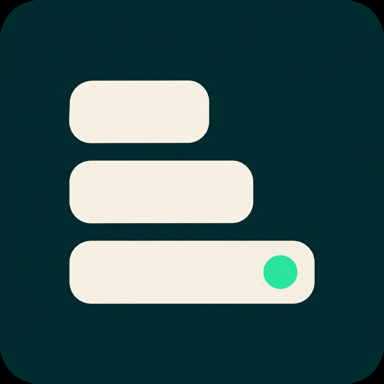
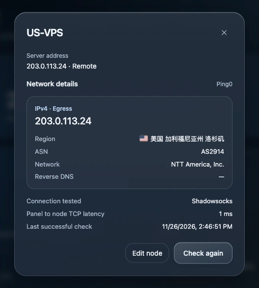

<p align="center"></p>

# EasyNode

[Website](https://easynode.cc.cd/?lang=en) · [简体中文](README.md) · English

**Manage your own proxy nodes from one web panel.** Your first VPS can run both the panel and a node. When you add another server, deploy it from the same panel, add its connections to an existing subscription and refresh that subscription on your devices.

### What can you do with EasyNode?

| Task | How it works |
| --- | --- |
| Set up your first node | Run one command on your VPS. The installer handles dependencies, installs or reuses a compatible sing-box and sets up HTTPS. Sign in with the URL and credentials printed in the terminal, then add the panel host as a node. |
| Bring another server online | Enter its SSH address, port and password and verify the host fingerprint. The panel deploys the node remotely and skips reinstallation when a matching configuration is already active. The SSH password is used only for that operation. |
| Choose protocols per server | Select any combination of Shadowsocks, VLESS + REALITY and Hysteria 2. The panel generates credentials and writes the configuration. For REALITY, you can also adjust the handshake target and listening port and test the connection. |
| Connect your devices | Pick connections across servers to create a subscription URL and QR code. Paste the URL into Clash Verge Rev or scan the code in Shadowrocket. The panel serves Clash configuration or a list of node links depending on the client. Refresh the same subscription after changing its connections. |
| Check a node’s actual egress | Open its details and choose **Check again**. The panel makes a request through one of the node’s connections to report the egress IP, region and network operator, along with available ASN and reverse DNS data and the time of the check. TCP latency is measured from panel to node. |
| Manage the panel address and account | Start with a public IPv4 address. Later, point a domain at the panel and enter it on the **Domain settings** tab. EasyNode checks DNS, requests a certificate and switches the address. Certificates renew automatically. You can also change your admin username and password under **Account**. |

**What runs on the VPS?** The EasyNode Go program serves the web interface, administrator login, deployment and subscriptions. Sing-box runs the selected protocols. Certbot manages certificates, and systemd manages services and renewal timers. Configuration and account data live in local files, so there is no separate database to install. Additional servers run the node service.

[Quick start](#quick-start) · [Supported systems](#supported-systems)


<details>
<summary>View node network details</summary>



</details>

To try the offline demo, download the repository and open [web/index.html](web/index.html) in your browser. Screenshots and previews use fictional data.

## Quick start

Start with a Linux VPS with a public IPv4 address, root access, Bash and curl. Allow TCP 80 and 443 and the ports for your chosen protocols in both the OS firewall and your provider’s security group. [Port reference](#port-reference)

**1. Install the panel.** Run this command on the VPS.

```bash
bash <(curl -fsSL https://raw.githubusercontent.com/sl2782087/easynode/v0.6.3/install.sh)
```

Press Enter if the suggested public IP is correct, or enter a domain that already points to this server. When installation finishes, the terminal prints the HTTPS URL and your admin credentials.

**2. Add your first node.** Sign in, open **Nodes → Add node**, select the panel host, give it a name and choose your protocols. When you save, the panel writes the configuration and starts the connections.

**3. Connect a client.** Open **Subscriptions → Create subscription** and select the connections you just added. Paste the URL into Clash Verge Rev on your computer or scan the QR code with Shadowrocket on your iPhone.

### Connect a domain to your panel

Point the A record directly at the panel VPS. If you publish an AAAA record, point it at the same VPS. Allow public TCP 80 and 443. On the **Domain settings** tab, enter the full hostname and select **Verify and enable HTTPS**. Sign in at the new domain with your existing account. Links and QR codes for existing and new subscriptions use this domain automatically. In clients that already use the old address, replace the link or scan the updated QR code from **Subscriptions**. The node list continues to show IP addresses.

## Add another VPS

Choose **Add node → Remote server** in the same panel. Enter its public IPv4 address, SSH port and root password. Verify the SSH host fingerprint and choose **Deploy and save**. The remote machine runs only the node service. Its SSH password is used for this operation only. Once deployment finishes, edit your existing subscription to include the new connections.

The node list identifies the panel host, remote nodes and their egress regions. Open a node to see its egress IP, network name, ASN and reverse DNS. The panel queries the free Ping0 endpoint through the node and caches the result. Choose **Check again** for a fresh reading.

### Per-node REALITY settings

Select VLESS + REALITY and expand **Advanced REALITY settings**. Keep the default `www.cloudflare.com`, choose the upstream example `dl.google.com`, or enter a custom hostname. Test TLS 1.3, certificate validation and HTTP/2 from the node before saving. Remote target checks require verified SSH access with TCP forwarding. Once saved, **Test saved REALITY connection** in the node details connects to Ping0 through that protocol. Results describe that path at the time of the test. [REALITY documentation](https://github.com/XTLS/REALITY)

The listener defaults to TCP 30444 and accepts an available port from 1024–65535. Remote nodes can also use an available 443. Port 443 on the panel host is reserved for the panel. Allow the new inbound TCP port and refresh the subscription after changing it. The handshake target always uses port 443.

## Supported systems

Both the panel host and remote nodes provisioned over SSH require a Linux VPS booted with systemd.

| Distribution | Supported versions | CPU architectures |
| --- | --- | --- |
| Debian | 12 (Bookworm), 13 (Trixie) | amd64, arm64 |
| Ubuntu Server LTS | 22.04 (Jammy), 24.04 (Noble), 26.04 (Resolute) | amd64, arm64 |
| Rocky Linux | 8 (8.10), 9, 10 | amd64, arm64 |
| CentOS Stream | 9, 10 | amd64, arm64 |

<details>
<summary>Test coverage and compatibility notes</summary>

Package installation, Python virtual environments and Certbot’s IP certificate option were checked in arm64 container images for every version in the table. Rocky 8.10 arm64 also ran the HTTPS panel, a service restart, the HY2 UDP listener and its renewal timer under systemd using a local test certificate. Public issuance, renewal and deployments with SELinux enforcing on the newly added systems still need live validation. Public end-to-end testing used Debian 12 amd64 for HTTPS sign-in, node management and client subscriptions. The installer checks the distribution, version, architecture and systemd before installing missing packages with APT or DNF. On Rocky 8, root stages certificates and node configuration in a protected runtime directory at service start, including restarts after renewal.

CentOS Linux 7/8 and CentOS Stream 8 have reached end of life. Windows can run subscription clients. Native Windows panel and node services are not available.

</details>

## Port reference

| Inbound port | Host | Purpose |
| --- | --- | --- |
| TCP 80 | Panel host and remote nodes with HY2 | Certificate issuance and automatic renewal. Certbot must be able to bind this publicly reachable port. |
| TCP 443 | Panel host | HTTPS panel and subscriptions |
| Configured SSH TCP port | Remote node, reachable from the panel host | Host key verification and provisioning |
| 30443 TCP/UDP, 30444 TCP, 30445 UDP | Each node running the corresponding protocol | Shadowsocks, VLESS + REALITY and Hysteria 2 respectively |

Allow the relevant ports in both the OS firewall and your provider’s security group. For domain access, point the DNS record to the panel host before installation.

## Maintenance

| Task | How |
| --- | --- |
| Upgrade the panel | Run the installation command again. The installer keeps your account, nodes and subscriptions and restarts the panel service. |
| Find initial credentials or change a password | As root, read `/etc/easynodedeck/initial-access` for the original credentials. Once signed in, use **Account** to change the username or password. Sessions last 12 hours and survive page reloads and service restarts. |
| Back up | Store a secure copy of `/var/lib/easynodedeck/state.json`. It contains administrator data, node credentials and subscription URLs. |
| Check service health | Run `systemctl status easynodedeck` on the panel host. For remote deployment errors, read `/var/log/easynodedeck-node-install.log` on the remote node. |
| Change local ports or the REALITY handshake domain | Set `SS_PORT`, `REALITY_PORT`, `HY2_PORT` or `REALITY_SNI` in `/etc/easynodedeck/panel.env`, then restart the panel service. |

The panel runs as a dedicated system user. The Go binary embeds the web UI and stores single-admin state in a private JSON file. There is no separate database to deploy.

<details>
<summary>Subscription formats, removal and reachability</summary>

- The subscription format is selected automatically for your client. Append `?format=clash` or `?format=uri` to choose one explicitly.
- Deleting a subscription revokes its download URL. Previously downloaded connections remain usable until their node credentials change.
- Removing a remote node requires SSH authentication again. The panel stops `easynodedeck-node.service` on that host and removes its connections from subscriptions.
- **Reachable** means the panel connected to the selected TCP listeners. UDP-only HY2 nodes show the last service status checked over SSH.

</details>

## Contributing

We welcome [issues](https://github.com/sl2782087/easynode/issues) in English or Chinese about installation, node management and client compatibility. For compatibility reports, include the operating system, client version and sanitized reproduction steps. Keep SSH credentials, private keys and active subscription URLs private.

Released under the [MIT License](LICENSE).
