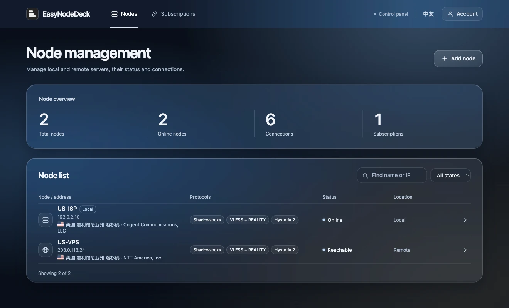

<p align="center"></p>

# EasyNodeDeck

[简体中文](README.md) · English

A lightweight, self-hosted panel for local and remote Linux nodes. Combine Shadowsocks, VLESS + REALITY and Hysteria 2 connections in stable subscription URLs and QR codes.



<details>
<summary>View node network details</summary>


</details>

Screenshots use the offline demo with fictional servers, documentation IPs and ASNs, and simulated network checks.

## Supported systems

Both the panel host and remote nodes provisioned over SSH require a Linux VPS booted with systemd.

| Distribution | Supported versions | CPU architectures |
| --- | --- | --- |
| Debian | 12 (Bookworm), 13 (Trixie) | amd64, arm64 |
| Ubuntu Server LTS | 22.04 (Jammy), 24.04 (Noble), 26.04 (Resolute) | amd64, arm64 |
| Rocky Linux | 8 (8.10), 9, 10 | amd64, arm64 |
| CentOS Stream | 9, 10 | amd64, arm64 |

Package installation, Python virtual environments and Certbot’s IP certificate option were checked in arm64 container images for every version in the table. Rocky 8.10 arm64 also ran the HTTPS panel, a service restart, the HY2 UDP listener and its renewal timer under systemd using a local test certificate. Public issuance, renewal and deployments with SELinux enforcing on the newly added systems still need live validation. Public end-to-end testing used Debian 12 amd64 for HTTPS sign-in, node management and client subscriptions. The installer checks the distribution, version, architecture and systemd before installing missing packages with APT or DNF. On Rocky 8, root stages certificates and node configuration in a protected runtime directory at service start, including restarts after renewal.

CentOS Linux 7/8 and CentOS Stream 8 have reached end of life. Windows can run subscription clients. Native Windows panel and node services are not available.

## Install or upgrade

Run the command below as root in a Bash shell on the panel VPS with curl installed. The installer accepts a public IPv4 address or a domain already pointing to the server. Leave the username and password blank to generate credentials.

```bash
bash <(curl -fsSL https://raw.githubusercontent.com/sl2782087/easynodedeck/v0.4.0/install.sh)
```

On first install, the terminal prints the HTTPS URL and administrator credentials. To upgrade, rerun the same command. It keeps your existing account, nodes and subscriptions and restarts the panel service.

| Inbound port | Host | Purpose |
| --- | --- | --- |
| TCP 80 | Panel host and remote nodes with HY2 | Certificate issuance and automatic renewal. Certbot must be able to bind this publicly reachable port. |
| TCP 443 | Panel host | HTTPS panel and subscriptions |
| Configured SSH TCP port | Remote node, reachable from the panel host | Host key verification and provisioning |
| 30443 TCP/UDP, 30444 TCP, 30445 UDP | Each node running the corresponding protocol | Shadowsocks, VLESS + REALITY and Hysteria 2 respectively |

Allow the relevant ports in both the OS firewall and your provider’s security group. For domain access, point the DNS record to the panel host before installation.

## Get a working subscription

1. Open the HTTPS address printed by the installer and sign in. Initial credentials are also saved to `/etc/easynodedeck/initial-access` with root-only permissions.
2. In **Nodes**, choose **Add node**, select the panel host or a remote server, name it and select protocols. The panel labels local nodes. Subscription clients also show the local marker (本机) in connection names.
3. In **Subscriptions**, choose **Create subscription**, select connections and copy the URL or scan the QR code. Import it into Clash Verge Rev or Shadowrocket. Editing the selection keeps the same URL. Use `?format=clash` or `?format=uri` to override client detection.
4. Open **Account** to change the administrator username or password. Removing a subscription revokes its URL. Clients that already downloaded a connection keep its credentials until the underlying node credentials change.

The node list shows the detected egress region, flag and network name. Open a node for its egress IP, ASN, reverse DNS and check time. The panel queries the free Ping0 endpoint through the node and caches the result. Choose **Check again** to refresh it. Sign-in sessions last 12 hours and survive page reloads and service restarts.

### Operations

The service runs as a dedicated system user. Go serves the embedded UI and supervises the local core. Single-administrator state is saved atomically in a private JSON file at `/var/lib/easynodedeck/state.json`. Back it up securely to retain credentials and subscription URLs. Inspect service health with `systemctl status easynodedeck`. Configure protocol ports and the REALITY handshake domain with `SS_PORT`, `REALITY_PORT`, `HY2_PORT` and `REALITY_SNI` in `/etc/easynodedeck/panel.env`, then restart the service.

### Remote VPS deployment

Enter a public IPv4 address, SSH port and root password. Verify the SSH host fingerprint and choose **Deploy and save**. The target needs systemd and an amd64 or arm64 CPU. HY2 uses a free, publicly reachable TCP port 80 for IP certificate issuance and renewal. Connections use the protocol ports listed above. The remote host runs a dedicated `easynodedeck-node.service`.

Repeating deployment reuses the node identity and matching configuration. The SSH password is used for the current operation only. Removing a remote node requires SSH authentication, stops its service and removes its connections from subscriptions. See `/var/log/easynodedeck-node-install.log` on the remote host for installation errors. Reachability in the node list reflects a check of the selected TCP listeners. UDP-only nodes use the last service check over SSH.

For an offline UI demonstration, open [web/index.html](web/index.html) directly as a local file.

## Contributing

We welcome [issues](https://github.com/sl2782087/easynodedeck/issues) in English or Chinese about installation, node management and client compatibility. For compatibility reports, include the operating system, client version and sanitized reproduction steps. Keep SSH credentials, private keys and active subscription URLs private.

Released under the [MIT License](LICENSE).
