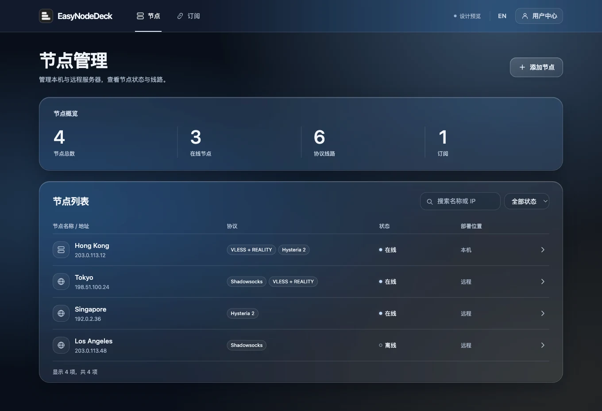

<p align="center"></p>

# EasyNodeDeck · 易节点

简体中文 · [English](README.en.md)

从一个面板管理本机和远程 Linux 节点，勾选 Shadowsocks、VLESS + REALITY 和 Hysteria 2 线路即可生成固定订阅地址及二维码。



<details>
<summary>查看节点网络详情</summary>


</details>

截图中的服务器和出口地址已替换为文档示例 IP。

## 支持的系统

下表适用于面板主机和通过 SSH 添加的远程节点。两者都需要以 systemd 启动的 Linux VPS。

| 发行版 | 支持版本 | CPU 架构 |
| --- | --- | --- |
| Debian | 12（Bookworm）、13（Trixie） | amd64、arm64 |
| Ubuntu Server LTS | 22.04（Jammy）、24.04（Noble）、26.04（Resolute） | amd64、arm64 |
| Rocky Linux | 8（8.10）、9、10 | amd64、arm64 |
| CentOS Stream | 9、10 | amd64、arm64 |

表中版本均在 arm64 发行版容器中验证了依赖安装、Python 虚拟环境和 Certbot 的 IP 证书选项。Rocky 8.10 arm64 另在独立 systemd 环境中用本地测试证书验证了面板 HTTPS、服务重启、HY2 节点 UDP 监听和续期定时器启动。新增系统上的公网签发、自动续期和 SELinux enforcing 部署仍待实机验证。公网端到端验证使用 Debian 12 amd64，覆盖 HTTPS 面板登录、添加节点和客户端订阅。安装器会先检查发行版、版本、架构和 systemd，再用 APT 或 DNF 补齐依赖。Rocky 8 使用仅 root 可写的运行时目录向服务提供证书和配置，续期重启会重新载入。

CentOS Linux 7/8 和 CentOS Stream 8 已结束维护。Windows 可作为订阅客户端，原生面板及节点服务尚未移植。

## 安装与升级

在面板 VPS 的 Bash 终端以 root 身份执行下面的命令，需要预装 curl。安装时可填写公网 IPv4，或填写已经解析到服务器的域名。用户名和密码留空会随机生成。

```bash
bash <(curl -fsSL https://raw.githubusercontent.com/sl2782087/easynodedeck/v0.4.0/install.sh)
```

首次安装完成后，终端会打印 HTTPS 地址和管理员账密。升级现有面板时运行同一条命令，安装器会沿用已有账户、节点和订阅，并重启面板服务。

| 入站端口 | 在哪台机器放行 | 用途 |
| --- | --- | --- |
| TCP 80 | 面板主机、启用 HY2 的远程节点 | 首次签发证书和自动续期，需公网可达且可供 Certbot 监听 |
| TCP 443 | 面板主机 | HTTPS 管理页面和订阅 |
| 配置的 SSH TCP 端口 | 远程节点，允许面板主机访问 | 验证主机指纹和部署节点 |
| 30443 TCP/UDP、30444 TCP、30445 UDP | 启用相应协议的节点 | 分别用于 Shadowsocks、VLESS + REALITY、Hysteria 2 |

端口同时受 VPS 系统防火墙和服务商安全组控制。若使用域名，请先将 DNS 记录指向面板主机。

## 生成可用订阅

1. 打开安装结束时显示的 HTTPS 地址并登录。初始账密也会保存在仅 root 可读的 `/etc/easynodedeck/initial-access`。
2. 在「节点」点击「添加节点」，选择本机或远程服务器，填写名称并勾选协议。本机线路在面板和订阅中均标记为「本机」。
3. 在「订阅」点击「创建订阅」，选择线路，复制地址或扫描二维码，在 Clash Verge Rev 或 Shadowrocket 中导入。调整线路后刷新原地址即可。需要指定输出格式时，在地址末尾加 `?format=clash` 或 `?format=uri`。
4. 在「用户中心」可以修改管理员用户名和密码。删除订阅会撤销下载地址，已下载的节点凭据会继续有效，直至底层节点凭据更换。

节点列表显示检测到的出口地区、旗帜和网络名称。打开详情可以查看出口 IP、ASN、反向域名和检测时间。面板通过节点线路访问 Ping0 免费接口并缓存结果，可按需重新检测。登录会话有效期为 12 小时，刷新页面或重启服务后仍然有效。

### 运维

面板以独立系统用户运行。Go 程序内嵌网页并管理本机节点进程。单管理员数据以私有 JSON 文件原子保存至 `/var/lib/easynodedeck/state.json`，备份此文件可以保留节点凭据和订阅地址。用 `systemctl status easynodedeck` 检查运行状态。在 `/etc/easynodedeck/panel.env` 中可指定 `SS_PORT`、`REALITY_PORT`、`HY2_PORT` 和 `REALITY_SNI`，修改后重启服务。

### 远程 VPS

输入目标机公网 IPv4、SSH 端口和 root 密码，核对 SSH 主机指纹后点击「部署并保存」。自定义 SSH 端口可用。远程机需有 systemd，支持 amd64 或 arm64。启用 HY2 时需要公网可达且空闲的 TCP 80 来签发和续期 IP 证书。线路使用与上文相同的默认协议端口。远程节点无需运行管理网页。

安装器单独管理 `easynodedeck-node.service`，重复部署会复用该节点的身份和相同配置。SSH 密码仅用于本次操作。移除远程节点需要再次输入密码，会停止该服务并从订阅移除其线路。排查部署问题可读取目标机的 `/var/log/easynodedeck-node-install.log`。列表中「端口可达」表示面板已连通所选 TCP 端口；纯 HY2 节点使用最近一次 SSH 服务检查结果。

浏览器直接打开本地 [web/index.html](web/index.html) 可试用离线设计预览。

## 参与

欢迎用中文或英文在 [Issues](https://github.com/sl2782087/easynodedeck/issues) 讨论安装体验、节点管理和客户端兼容性。反馈兼容问题时，请附操作系统、客户端版本和脱敏后的复现步骤。请勿公开 SSH 凭据、私钥或真实订阅地址。

本项目采用 [MIT 许可证](LICENSE)。
