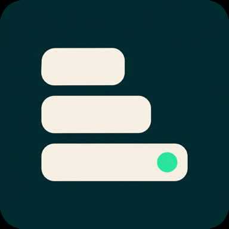
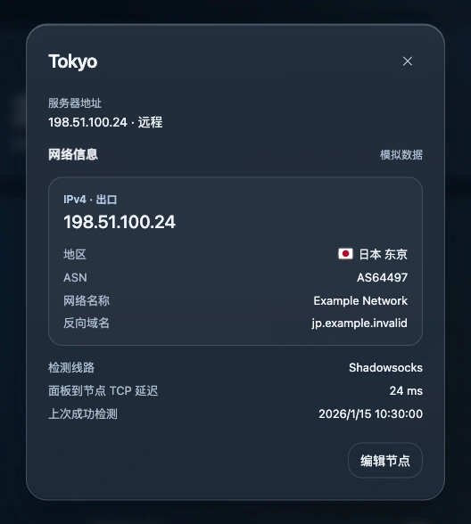

<p align="center"></p>

# EasyNode · 易节点

[官网](https://easynode.cc.cd/) · 简体中文 · [English](README.en.md)

**用一个网页管理自己的代理节点。** 第一台 VPS 可以同时运行面板和节点。以后再添一台服务器，直接在原面板里部署，把新线路加进已有订阅，手机和电脑刷新后就能使用。

### EasyNode 能替你做什么？

| 你想做的事 | 在 EasyNode 里怎么做 |
| --- | --- |
| 在新 VPS 上搭好第一个节点 | 用一条命令安装面板。脚本补齐依赖、安装或复用兼容的 sing-box，并配置 HTTPS。用终端给出的网址和账密登录，选择「添加节点 → 本机」。 |
| 加入另一台服务器 | 填写 SSH 地址、端口和密码，核对主机指纹后由面板远程部署。已在运行且配置相同的节点会跳过重复安装。SSH 密码只在本次操作中使用。 |
| 给不同机器选不同协议 | 每台都能勾选 Shadowsocks、VLESS + REALITY、Hysteria 2 中的一种或多种。面板生成连接凭据并写配置。REALITY 的握手目标和监听端口也可以按节点调整、测试。 |
| 让手机和电脑用上这些线路 | 从多台机器勾选线路，生成订阅链接和二维码。Clash Verge Rev 粘贴链接，Shadowrocket 扫码即可导入。面板按客户端返回 Clash 配置或通用节点链接，增减线路后可刷新原订阅。 |
| 确认实际出口 | 在节点详情点「重新检测」，面板会通过该节点的一条线路查询出口 IP、地区和运营商，显示可获得的 ASN、反向域名和检测时间。TCP 延迟指面板到节点的耗时。 |
| 管理面板地址和账号 | 公网 IPv4 即可起步。有域名后先配置 DNS，再从顶部「域名配置」页绑定，面板会验证解析、申请证书并切换地址。证书自动续期，管理员可以在用户中心修改用户名和密码。 |

**一台 VPS 上运行哪些东西？** EasyNode 的 Go 程序提供网页、管理员登录、部署和订阅接口。sing-box 负责运行所选协议。Certbot 管理证书，systemd 管理服务与续期定时器。配置和账号数据保存在本机文件中，无需单独部署数据库。远程 VPS 只需部署节点服务。

[快速开始](#快速开始) · [支持的系统](#支持的系统)


<details>
<summary>查看节点网络详情</summary>



</details>

将仓库下载到本机后，直接用浏览器打开 [web/index.html](web/index.html) 即可试用。截图和预览均使用模拟数据。

## 快速开始

准备一台有公网 IPv4 的 Linux VPS，以 root 登录 Bash，确认已安装 curl。在系统防火墙和云安全组放行 TCP 80、443，以及准备使用的协议端口。[端口清单](#端口清单)

**1. 安装面板。** 在 VPS 上执行下面的命令。

```bash
bash <(curl -fsSL https://raw.githubusercontent.com/sl2782087/easynode/v0.6.3/install.sh)
```

提示的公网 IP 正确就按回车，也可以填写已解析到这台 VPS 的域名。安装完成后，终端会打印 HTTPS 地址、用户名和密码。

**2. 添加第一个节点。** 浏览器打开面板并登录，在「节点 → 添加节点」选择「本机」，填个容易辨认的名字，勾选协议并保存。面板会生成配置并启动线路。

**3. 在客户端导入。** 打开「订阅 → 创建订阅」，勾选刚才的线路。在电脑的 Clash Verge Rev 中粘贴订阅地址，或用 iPhone 上的 Shadowrocket 扫描二维码。

### 给面板和订阅绑定域名

先把域名的 A 记录指向面板 VPS 的公网 IPv4。如果添加了 AAAA 记录，也需指向该机的 IPv6。使用 DNS 直连，放行 TCP 80 和 443。登录面板，打开顶部的「域名配置」页，输入完整域名，点击「验证并启用 HTTPS」。证书签发后即可用新域名登录面板。已有和新建订阅的链接、二维码都会使用新域名。已经导入旧地址的客户端，可到「订阅」复制新链接或重新扫码。节点列表仍显示 IP。

## 添加另一台 VPS

在同一面板选择「添加节点 → 远程服务器」，输入公网 IPv4、SSH 端口和 root 密码。核对 SSH 主机指纹后点击「部署并保存」。远程机只运行节点服务，SSH 密码仅用于本次操作。部署完成后，编辑已有订阅，勾选新线路即可。

列表会标出本机、远程节点及出口地区。想确认流量从哪里出去，可以打开节点详情查看出口 IP、网络名称、ASN 和反向域名。面板通过节点线路查询 Ping0 免费接口并缓存结果，点击「重新检测」可刷新。

### 按节点调整 REALITY

勾选 VLESS + REALITY 后可展开「REALITY 高级设置」。默认目标是 `www.cloudflare.com`，另提供上游文档举例的 `dl.google.com`，也可以输入自选域名。保存前可从节点测试目标的 TLS 1.3、证书及 HTTP/2；远程测试需要验证 SSH 主机并允许 TCP 转发。保存后在节点详情点击「测试已保存的 REALITY 线路」，面板会通过该协议访问 Ping0 验证连接。测试结果只代表本次连接和测量位置。[REALITY 上游文档](https://github.com/XTLS/REALITY)

节点默认监听 TCP 30444，可改为 1024–65535 中的空闲端口。远程节点也可选空闲的 443。本机 443 留给管理面板。改端口后需放行相应的入站 TCP 并刷新原订阅。目标网站端口固定为 443。

## 支持的系统

下表适用于面板主机和通过 SSH 添加的远程节点。两者都需要以 systemd 启动的 Linux VPS。

| 发行版 | 支持版本 | CPU 架构 |
| --- | --- | --- |
| Debian | 12（Bookworm）、13（Trixie） | amd64、arm64 |
| Ubuntu Server LTS | 22.04（Jammy）、24.04（Noble）、26.04（Resolute） | amd64、arm64 |
| Rocky Linux | 8（8.10）、9、10 | amd64、arm64 |
| CentOS Stream | 9、10 | amd64、arm64 |

<details>
<summary>测试范围与兼容性说明</summary>

表中版本均在 arm64 发行版容器中验证了依赖安装、Python 虚拟环境和 Certbot 的 IP 证书选项。Rocky 8.10 arm64 另在独立 systemd 环境中用本地测试证书验证了面板 HTTPS、服务重启、HY2 节点 UDP 监听和续期定时器启动。新增系统上的公网签发、自动续期和 SELinux enforcing 部署仍待实机验证。公网端到端验证使用 Debian 12 amd64，覆盖 HTTPS 面板登录、添加节点和客户端订阅。安装器会先检查发行版、版本、架构和 systemd，再用 APT 或 DNF 补齐依赖。Rocky 8 使用仅 root 可写的运行时目录向服务提供证书和配置，续期重启会重新载入。

CentOS Linux 7/8 和 CentOS Stream 8 已结束维护。Windows 可作为订阅客户端，原生面板及节点服务尚未移植。

</details>

## 端口清单

| 入站端口 | 在哪台机器放行 | 用途 |
| --- | --- | --- |
| TCP 80 | 面板主机、启用 HY2 的远程节点 | 首次签发证书和自动续期，需公网可达且可供 Certbot 监听 |
| TCP 443 | 面板主机 | HTTPS 管理页面和订阅 |
| 配置的 SSH TCP 端口 | 远程节点，允许面板主机访问 | 验证主机指纹和部署节点 |
| 30443 TCP/UDP、30444 TCP、30445 UDP | 启用相应协议的节点 | 分别用于 Shadowsocks、VLESS + REALITY、Hysteria 2 |

端口同时受 VPS 系统防火墙和服务商安全组控制。若使用域名，请先将 DNS 记录指向面板主机。

## 日常维护

| 要做什么 | 在哪里操作 |
| --- | --- |
| 升级面板 | 重新执行上面的安装命令，安装器会保留账户、节点和订阅，并重启服务。 |
| 找回初始账密或修改密码 | root 可读取 `/etc/easynodedeck/initial-access` 查看首次安装的账密。登录后可在「用户中心」修改用户名和密码。会话有效期为 12 小时，支持刷新和服务重启。 |
| 备份 | 安全保存 `/var/lib/easynodedeck/state.json`，其中包含管理员数据、节点凭据和订阅地址。 |
| 检查服务 | 在面板主机执行 `systemctl status easynodedeck`。远程部署失败时查看远程机上的 `/var/log/easynodedeck-node-install.log`。 |
| 修改本机线路端口或 REALITY 握手域名 | 在 `/etc/easynodedeck/panel.env` 设置 `SS_PORT`、`REALITY_PORT`、`HY2_PORT` 或 `REALITY_SNI`，然后重启面板服务。 |

面板以独立系统用户运行。Go 程序内嵌网页，单管理员数据保存在一个私有 JSON 文件里，无需单独部署数据库。

<details>
<summary>订阅格式、移除节点和状态说明</summary>

- 订阅默认按客户端选择格式。手动指定时，在地址末尾加 `?format=clash` 或 `?format=uri`。
- 删除订阅会撤销下载地址。客户端已下载的线路仍能使用，直到底层节点凭据更换。
- 移除远程节点时需要再次进行 SSH 验证。面板会停止远程机上的 `easynodedeck-node.service`，并从订阅中移除相关线路。
- 「端口可达」表示面板能连接节点所选的 TCP 监听端口。纯 HY2 节点显示最近一次通过 SSH 检查的服务状态。

</details>

## 参与

欢迎用中文或英文在 [Issues](https://github.com/sl2782087/easynode/issues) 讨论安装体验、节点管理和客户端兼容性。反馈兼容问题时，请附操作系统、客户端版本和脱敏后的复现步骤。请勿公开 SSH 凭据、私钥或真实订阅地址。

本项目采用 [MIT 许可证](LICENSE)。
